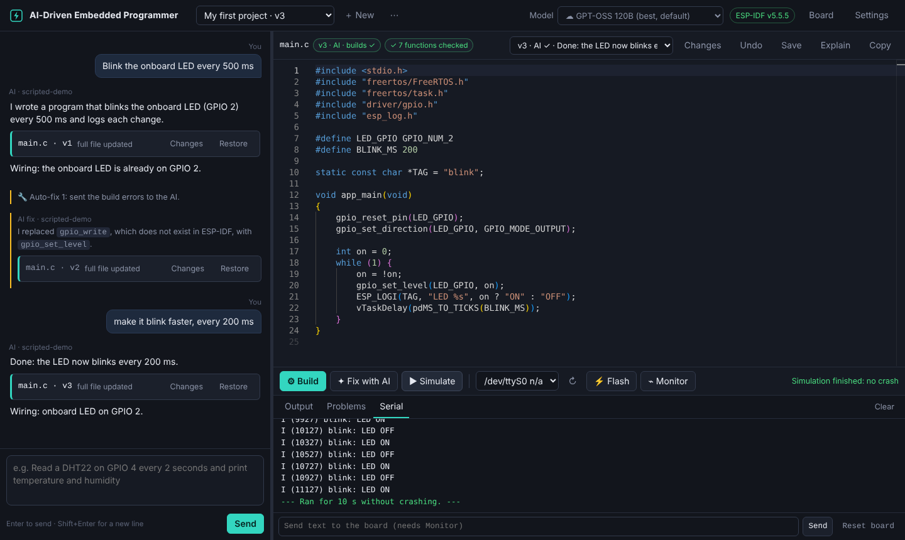

# AI-Driven Embedded Programmer

**Chat with an AI to write ESP32 firmware, then keep chatting to change it.**
BE project, ENTC group ET1, PES Modern College of Engineering, Pune (guide: Prof. R. S. Kamathe).

Describe what the ESP32 should do in plain English. The AI writes complete
ESP-IDF v5.5 C code, the app checks that every function really exists, builds
it with the real ESP-IDF toolchain, fixes build errors with the AI, and lets
you run it in a simulator or flash it to a board — all from one screen.



## Features

| | |
|---|---|
| **Chat → complete code** | Plain-English request → a complete `main.c` for ESP32 (ESP-IDF v5.5), streamed live |
| **Tweak by chatting** | "make it faster", "use GPIO 5", "add a button" — the AI edits the current code |
| **Edit by hand** | The code panel is a real editor (Monaco, from VS Code). The AI sees and keeps your edits |
| **See every change** | Red/green before-after view for each AI change, with one-click undo |
| **Version history** | Every change (AI, auto-fix, your edits, restores) is a new version; nothing is overwritten |
| **Real ESP-IDF examples** | For each request the closest official ESP-IDF examples are found and given to the AI |
| **Made-up function check** | Every called function is checked against the real ESP-IDF headers |
| **Build + auto-fix** | Real `idf.py build`; errors (explained in plain words) go back to the AI, up to 3 tries |
| **Simulate** | Run the firmware in Espressif's ESP32 simulator (QEMU) without a board |
| **Flash + serial monitor** | Flash the board and watch / send serial data live |
| **Explain code** | Simple, step-by-step explanation of the current program |
| **Board & wiring** | Tell the AI which parts are on which pins; it uses exactly those |
| **Two models** | Groq cloud **GPT-OSS 120B** (best, free tier) or **Qwen2.5-Coder 7B** on your laptop (offline) |
| **Projects** | Saved automatically; download as .zip or open in VS Code |

## Quick start (Windows)

1. Install **ESP-IDF v5.5** (already done on the team laptop) and, for the offline model, **[Ollama](https://ollama.com/download)**.
2. Double-click **`Setup.bat`** (one time: installs packages, the editor, the simulator, and optionally the local model).
3. Double-click **`Start.bat`**. The app opens at <http://127.0.0.1:8765>.
4. Open **Settings**, paste your free Groq key from <https://console.groq.com/keys>, press *Test connection*.
5. Type what the ESP32 should do.

Full instructions in simple steps: **[docs/USER_GUIDE.md](docs/USER_GUIDE.md)**.

## How it works

```
your request ─┐
board/wiring ─┼─► prompt (ESP-IDF v5.5 rules + pin safety + 2 matching official examples + current code)
current code ─┘        │
                       ▼
             AI model (Groq GPT-OSS 120B  or  local Qwen2.5-Coder 7B), streamed
                       │
                       ▼
             complete main.c ─► new version ─► made-up function check
                       │
                       ▼
             real ESP-IDF build ──fail──► errors back to the AI (max 3) ──┐
                       │ ok                                                │
                       ▼                                                   │
             Simulate (QEMU)  /  Flash + Serial monitor  ◄─────────────────┘
```

| Folder | What is inside |
|---|---|
| `app/main.py` | Web server (FastAPI): pages, API, live streams, serial WebSocket |
| `app/assistant.py` | One chat turn end to end: prompt → model → version → check → build → auto-fix |
| `app/llm/` | Groq and Ollama clients (streaming, rate limits), prompts and reply parsing |
| `app/knowledge/` | Search over the installed ESP-IDF examples; real function-name index |
| `app/esp/` | Find ESP-IDF, build, simulate, flash, serial monitor |
| `app/projects.py` | Projects, chat history, versions |
| `web/` | The browser app (plain JavaScript + Monaco editor) |
| `scripts/` | Setup, evaluation (20 test requests) |
| `docs/` | User guide, decision log, evaluation results |

Everything you create is stored in `data/` (git-ignored): settings (including
your API key), projects, caches and the build folder.

## Tests

```
.venv\Scripts\python -m pip install -r requirements-dev.txt
.venv\Scripts\python -m pytest -q
```

17 automatic tests (no internet or ESP-IDF needed). Set `RUN_IDF_TESTS=1` to
also run a real ESP-IDF build and simulator test.

Evaluation on 20 typical requests with the real model:
`.venv\Scripts\python scripts\evaluate.py` (results in `data/eval/`, summary in
[docs/EVALUATION.md](docs/EVALUATION.md)).

## Limits (v1)

- Only the classic **ESP32** (WROOM-32 DevKit) and only `main.c` (single-file projects).
- The simulator cannot fake sensors, buttons or analog inputs; it shows boot logs and output only.
- "It builds" does not prove it works on real hardware — test on a board.
- Groq's free tier allows about 8,000 tokens per minute; the app waits and retries automatically.
- The local 7B model is weaker than GPT-OSS 120B, especially with less common ESP-IDF APIs.

Design decisions and their reasons: [docs/decisions.md](docs/decisions.md).
